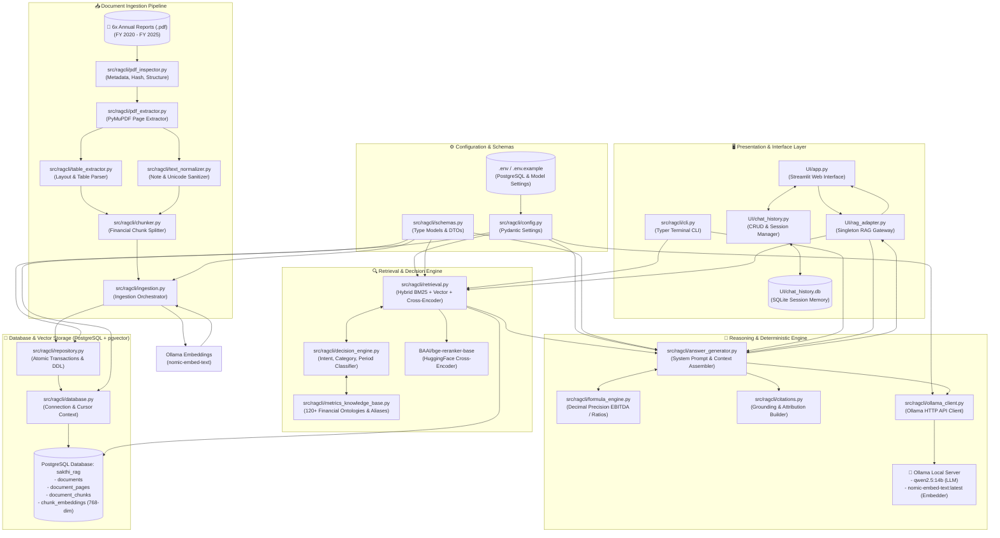
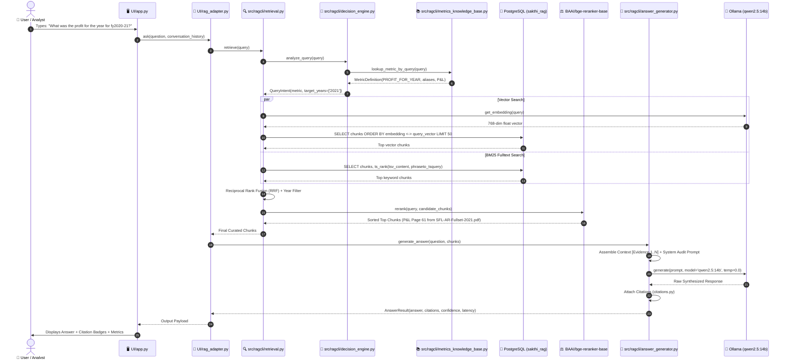

# Sakthi Finance RAG — System Architecture & File Connection Map

This document provides a comprehensive blueprint of the Sakthi Finance Financial RAG System. It details every component, file connection, and step-by-step dataflow across **Ingestion**, **Database Storage**, **Query Processing & Retrieval**, **Decision Engine / Knowledge Base Routing**, **Deterministic Calculations**, **Answer Generation**, and the **Streamlit Web UI**.

---

## 1. High-Level Architecture Diagram

---

## 2. File-by-File Connections & Responsibilities

### Tier 1: User Interface & Entrypoints

| File | Depends On (Imports) | Used By (Consumers) | Primary Role |
|---|---|---|---|
| [`UI/app.py`](file:///Users/breakthru/Desktop/Praveen/Rag/UI/app.py) | `chat_history.py`, `rag_adapter.py` | Browser Users (Port 8501) | Streamlit Web Chat UI, conversation selector, citation cards, and markdown rendering. |
| [`UI/chat_history.py`](file:///Users/breakthru/Desktop/Praveen/Rag/UI/chat_history.py) | `sqlite3` (`UI/chat_history.db`) | `UI/app.py` | Permanent SQLite storage for multi-session chat histories, titles, and timestamps. |
| [`UI/rag_adapter.py`](file:///Users/breakthru/Desktop/Praveen/Rag/UI/rag_adapter.py) | `retrieval.py`, `answer_generator.py` | `UI/app.py` | Singleton pattern bridge that coordinates retrieval and answer generation for the UI without altering backend logic. |
| [`src/ragcli/cli.py`](file:///Users/breakthru/Desktop/Praveen/Rag/src/ragcli/cli.py) | `ingestion.py`, `retrieval.py`, `answer_generator.py`, `database.py` | Terminal Users (`ragcli query`) | Typer-based Command-Line Interface providing terminal search, ingestion progress, and DB health inspection. |

---

### Tier 2: Document Ingestion Pipeline

| File | Depends On (Imports) | Used By (Consumers) | Primary Role |
|---|---|---|---|
| [`src/ragcli/pdf_inspector.py`](file:///Users/breakthru/Desktop/Praveen/Rag/src/ragcli/pdf_inspector.py) | `schemas.py`, `fitz` (PyMuPDF) | `pdf_extractor.py` | Computes SHA-256 file hashes for deduplication and extracts PDF document page counts and dimensions. |
| [`src/ragcli/table_extractor.py`](file:///Users/breakthru/Desktop/Praveen/Rag/src/ragcli/table_extractor.py) | `schemas.py`, `fitz` | `pdf_extractor.py` | Identifies tabular line bounding boxes, parses column headers, and reconstructs Markdown financial tables. |
| [`src/ragcli/text_normalizer.py`](file:///Users/breakthru/Desktop/Praveen/Rag/src/ragcli/text_normalizer.py) | Standard regex | `pdf_extractor.py`, `retrieval.py` | Normalizes OCR artefacts, cleans Note numbering (e.g. `Note 25`), currency characters (`₹`, `` ` ``), and Indian commas. |
| [`src/ragcli/pdf_extractor.py`](file:///Users/breakthru/Desktop/Praveen/Rag/src/ragcli/pdf_extractor.py) | `pdf_inspector.py`, `table_extractor.py`, `text_normalizer.py`, `schemas.py` | `ingestion.py` | Orchestrates page-by-page narrative extraction alongside reconstructed tables while preserving reading order. |
| [`src/ragcli/chunker.py`](file:///Users/breakthru/Desktop/Praveen/Rag/src/ragcli/chunker.py) | `schemas.py`, `config.py` | `ingestion.py` | Financial-aware chunker: keeps tables atomic, splits narrative paragraphs cleanly, and tags chunks with fiscal years and page numbers. |
| [`src/ragcli/ingestion.py`](file:///Users/breakthru/Desktop/Praveen/Rag/src/ragcli/ingestion.py) | `pdf_extractor.py`, `chunker.py`, `ollama_client.py`, `repository.py` | `cli.py` | Complete ingestion orchestrator: parses PDF &rarr; creates chunks &rarr; generates `nomic-embed-text` embeddings &rarr; writes to DB. |

---

### Tier 3: Storage & Database Access Layer

| File | Depends On (Imports) | Used By (Consumers) | Primary Role |
|---|---|---|---|
| [`src/ragcli/config.py`](file:///Users/breakthru/Desktop/Praveen/Rag/src/ragcli/config.py) | `pydantic_settings`, `.env` | Entire codebase | Validates environment variables (`DB_NAME`, `LLM_MODEL`, `EMBEDDING_DIM`, `RETRIEVAL_TOP_K`, `RERANKER_PATH`). |
| [`src/ragcli/database.py`](file:///Users/breakthru/Desktop/Praveen/Rag/src/ragcli/database.py) | `psycopg`, `pgvector`, `config.py` | `repository.py`, `retrieval.py` | Manages raw PostgreSQL connections, transactional cursor contexts (`get_db_cursor`), and registers vector types. |
| [`src/ragcli/repository.py`](file:///Users/breakthru/Desktop/Praveen/Rag/src/ragcli/repository.py) | `database.py`, `schemas.py` | `ingestion.py` | Manages schema creation (`documents`, `document_pages`, `document_chunks`, `chunk_embeddings`) and atomic batch inserts. |

---

### Tier 4: Knowledge Base, Retrieval & Decision Routing

| File | Depends On (Imports) | Used By (Consumers) | Primary Role |
|---|---|---|---|
| [`src/ragcli/metrics_knowledge_base.py`](file:///Users/breakthru/Desktop/Praveen/Rag/src/ragcli/metrics_knowledge_base.py) | `schemas.py` | `decision_engine.py`, `retrieval.py` | **Master Catalogue**: Contains 120+ standard Ind AS metrics, aliases, statutory categories, and appointment schemas. Zero hardcoded question/answer numbers. |
| [`src/ragcli/decision_engine.py`](file:///Users/breakthru/Desktop/Praveen/Rag/src/ragcli/decision_engine.py) | `metrics_knowledge_base.py` | `retrieval.py`, `answer_generator.py` | Query intent classifier: determines target metric, comparison periods, calculation needs, and statement type. |
| [`src/ragcli/retrieval.py`](file:///Users/breakthru/Desktop/Praveen/Rag/src/ragcli/retrieval.py) | `database.py`, `ollama_client.py`, `decision_engine.py`, `metrics_knowledge_base.py`, Cross-Encoder | `rag_adapter.py`, `cli.py` | **Hybrid Search Engine**: Combines full-text BM25 (`tsquery`), dense vector similarity (`<->`), Knowledge Base routing, and BGE cross-encoder reranking. |

---

### Tier 5: Generation, Calculations & Citations

| File | Depends On (Imports) | Used By (Consumers) | Primary Role |
|---|---|---|---|
| [`src/ragcli/formula_engine.py`](file:///Users/breakthru/Desktop/Praveen/Rag/src/ragcli/formula_engine.py) | `decimal.Decimal` | `answer_generator.py` | Precision deterministic mathematical engine for derived metrics (EBITDA, CRAR, Net Profit Margin) without LLM hallucinations. |
| [`src/ragcli/citations.py`](file:///Users/breakthru/Desktop/Praveen/Rag/src/ragcli/citations.py) | `schemas.py` | `answer_generator.py` | Assembles metadata badges (Document Name, Page Number, Section Title, Table ID, Financial Period). |
| [`src/ragcli/ollama_client.py`](file:///Users/breakthru/Desktop/Praveen/Rag/src/ragcli/ollama_client.py) | `httpx`, `config.py` | `ingestion.py`, `retrieval.py`, `answer_generator.py` | Local Ollama REST client for embedding generation (`nomic-embed-text`) and LLM streaming completion (`qwen2.5:14b`). |
| [`src/ragcli/answer_generator.py`](file:///Users/breakthru/Desktop/Praveen/Rag/src/ragcli/answer_generator.py) | `ollama_client.py`, `decision_engine.py`, `citations.py`, `formula_engine.py` | `rag_adapter.py`, `cli.py` | Constructs audit-grade system prompt, organizes multi-evidence context, enforces Markdown tables, and calls LLM. |

---

## 3. End-to-End Query Lifecycle (Step-by-Step)

